# ZIO OpenFeature

[](https://github.com/EtaCassiopeia/zio-openfeature/actions/workflows/ci.yml)
[](https://central.sonatype.com/artifact/io.github.etacassiopeia/zio-openfeature-core_3)
[](https://etacassiopeia.github.io/zio-openfeature/)

Type-safe feature flags for ZIO, on top of the [OpenFeature](https://openfeature.dev) Java SDK. Use any OpenFeature
provider (LaunchDarkly, flagd, Flagsmith, Flipt, OFREP, Optimizely, …) and read flags as ZIO effects with typed
errors, layered targeting context, ZIO hooks, transactions and provider events as a stream.

<p align="center">
  
</p>

**[Documentation](https://etacassiopeia.github.io/zio-openfeature/)**:
[getting started](https://etacassiopeia.github.io/zio-openfeature/getting-started/),
[evaluating flags](https://etacassiopeia.github.io/zio-openfeature/evaluating/),
[typed flags](https://etacassiopeia.github.io/zio-openfeature/typed-flags/),
[providers](https://etacassiopeia.github.io/zio-openfeature/providers/),
[testing](https://etacassiopeia.github.io/zio-openfeature/testkit/),
[under the hood](https://etacassiopeia.github.io/zio-openfeature/architecture/).

```scala
libraryDependencies ++= Seq(
  "io.github.etacassiopeia" %% "zio-openfeature-core"    % "<version>",
  "io.github.etacassiopeia" %% "zio-openfeature-extras"  % "<version>", // EnvVarProvider, below
  "io.github.etacassiopeia" %% "zio-openfeature-testkit" % "<version>" % Test
)
```

```scala
object MyApp extends ZIOAppDefault:

  val program: ZIO[FeatureFlags, Nothing, Unit] =
    for
      // never fails: serves false if the flag is missing or the provider is down
      enabled <- FeatureFlags.booleanOrDefault("my-feature", default = false)
      _       <- ZIO.when(enabled)(ZIO.logInfo("my-feature is on"))
    yield ()

  // Flags from environment variables (FF_MY_FEATURE=true); swap in any OpenFeature provider
  def run = program.provide(FeatureFlags.fromProvider(EnvVarProvider()))

// In tests, the in-memory provider from the testkit
MyApp.program.provide(TestFeatureProvider.layer(Map("my-feature" -> true)))
```

`booleanOrDefault` never fails and serves the default instead; `boolean` fails with a `FeatureFlagError` when the flag
cannot be read, for gates that must fail closed. Declare a flag once with `FlagDef` and read enums and case classes
with `derives FlagType`.

| Module | What it holds |
|---|---|
| `zio-openfeature-core` | The `FeatureFlags` service, context, hooks, transactions, events |
| `zio-openfeature-extras` | HOCON and environment-variable providers; caching, circuit-breaker and deferred wrappers |
| `zio-openfeature-ofrep` | An OFREP (OpenFeature Remote Evaluation Protocol) provider |
| `zio-openfeature-optimizely` | An Optimizely Feature Experimentation provider |
| `zio-openfeature-testkit` | `TestFeatureProvider` and test helpers |

| ZIO OpenFeature | OpenFeature spec | OpenFeature Java SDK |
|---|---|---|
| 1.2.0 (upcoming) | [v0.9.0](https://github.com/open-feature/spec/releases/tag/v0.9.0) | 1.23.0 |
| 1.1.x | [v0.9.0](https://github.com/open-feature/spec/releases/tag/v0.9.0) | 1.22.1 |
| 1.0.0 | [v0.8.0](https://github.com/open-feature/spec/releases/tag/v0.8.0) | 1.21.0 |

Scala 3.3+ and 2.13, ZIO 2.1, JDK 11+. Server-side (dynamic context) paradigm of the OpenFeature specification;
see [spec compliance](https://etacassiopeia.github.io/zio-openfeature/spec-compliance/). Apache 2.0.
