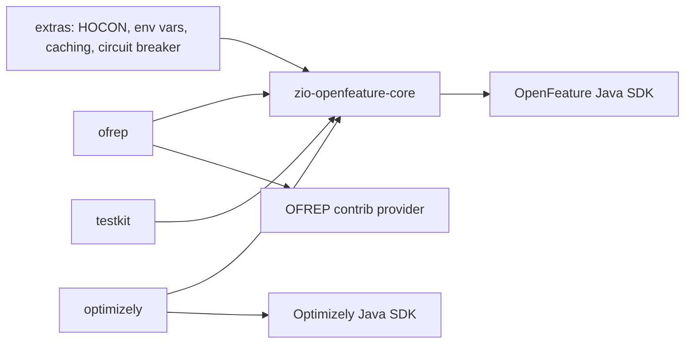

# Under the hood

ZIO OpenFeature is a ZIO layer over the [OpenFeature Java SDK](https://openfeature.dev/docs/reference/technologies/server/java).
The SDK holds the provider and talks to it. `FeatureFlags` adds what the SDK does not have: effects and typed errors,
fiber-local context, ZIO hooks, transactions, a provider status you can rely on, and events as a stream. The SDK's
`Hook` becomes `FeatureHook`, its `EvaluationContext` becomes ours, and its event handlers become `onProviderReady`,
`onConfigurationChanged` and `FeatureFlags.events`.

## The pieces

| Piece | What it is | Where it lives |
|---|---|---|
| `FeatureFlags` | The service your code calls | a `ZLayer`, built by one of the [factories](providers.md) |
| `OpenFeatureAPI` | The SDK's registry of providers and API-level hooks | the global singleton, or an isolated instance per [`FeatureFlagRegistry`](providers.md) |
| `Client` | The SDK object that evaluates flags | one per `FeatureFlags`, internal |
| `FeatureProvider` | Any OpenFeature Java provider | passed to the factory |

## One evaluation, step by step

1. **Context.** Six levels merge into one, each overriding the ones before: global, transaction, client, context
   source, scoped (`withContext`), the call's own. See [Evaluation context](context.md).
2. **Before hooks** run: API-level ZIO hooks, client hooks, the call's own hooks. See [Hooks](hooks.md).
3. **Transaction.** An override, or a flag already read with caching on, answers at once with reason `CACHED`. See
   [Transactions](transactions.md).
4. **Status gate.** `NotReady`, `ShuttingDown` and `Fatal` fail fast; `Ready`, `Stale` and `Error` go through. See
   [Lifecycle and events](lifecycle.md).
5. **Provider.** The SDK client is called on the blocking pool, with a timeout. The timed-out call is abandoned, not
   cancelled; see [Evaluating flags](evaluating.md) for the timeout and the cap on abandoned calls.
6. **After or error hooks** run in reverse order. An error code on the resolution runs `error`, not `after`.
7. **finallyAfter** hooks run last, whatever happened.
8. **Your answer.** The typed tier turns an error code into a `FeatureFlagError`; the total tier serves your default.

Hooks run on every path, including overrides, cache hits and a provider that is not ready.

## Threads and state

| What | Runs or lives on | Scope |
|---|---|---|
| Context merge, hooks, transaction lookup, status gate | the calling fiber | one evaluation |
| Provider call, SDK-level hooks, the provider's own hooks | ZIO's blocking pool, inside the SDK call | one evaluation |
| Provider events | the SDK's threads, bridged into ZIO, then published on a sliding hub of 256 events (a slow subscriber loses the oldest) | the instance |
| Global and client context | `Ref` | the `FeatureFlags` instance |
| Scoped context (`withContext`) | `FiberRef` | the fiber and its children |
| Transaction (overrides, cache, recorded flags) | `FiberRef` | the transaction block |
| Hooks | `Ref`; a registry adds its API-level ZIO hooks to every client | the instance |
| Provider status | a serialized state machine | the instance |

Scoped context and transactions are fiber-local, so concurrent requests never see each other's targeting or overrides.

## Sharing the SDK

Whether an instance shares the SDK's global `OpenFeatureAPI` or owns an isolated one, and who shuts it down, is set by
the factory: see [Wiring a provider](providers.md).

## Modules

Only `core` is required; the others are separate artifacts, so you pull in an HTTP stack or the Optimizely SDK only if
you use them.
