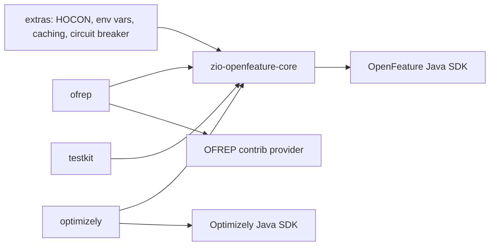

# Under the hood

ZIO OpenFeature is a ZIO layer over the [OpenFeature Java SDK](https://openfeature.dev/docs/reference/technologies/server/java).
The SDK holds the provider and talks to it. `FeatureFlags` adds what the SDK does not have: effects and typed errors,
fiber-local context, ZIO hooks, transactions, a provider status you can rely on, and events as a stream.

## The pieces

| Piece | What it is | Where it lives |
|---|---|---|
| `FeatureFlags` | The service your code calls | a `ZLayer`, built by one of the [factories](providers.md) |
| `OpenFeatureAPI` | The SDK's registry of providers and API-level hooks | the global singleton, or an isolated instance per [`FeatureFlagRegistry`](providers.md) |
| `Client` | The SDK object that evaluates flags | one per `FeatureFlags`, internal |
| `FeatureProvider` | Any OpenFeature Java provider | passed to the factory |
| `EvaluationContext` | Targeting attributes | an immutable Scala value, converted to the SDK's type per call |
| `FeatureHook` | A ZIO hook | run by `FeatureFlags` on your fiber |
| `ProviderEvent` | Provider readiness and change notifications | published on a ZIO `Hub` |

The OpenFeature concepts map one to one: the SDK's `Hook` becomes `FeatureHook`, its `EvaluationContext` becomes
ours, its event handlers become `onProviderReady`, `onConfigurationChanged` and `FeatureFlags.events`.

## One evaluation, step by step

1. **Context.** Six levels merge into one context, each overriding the ones before it: global, transaction, client,
   context source, scoped (`withContext`), then the context passed to the call. See [Evaluation context](context.md).
2. **Before hooks** run in order: API-level ZIO hooks, then client hooks, then the call's own hooks. Each can add
   context, which lands on top of everything else. See [Hooks](hooks.md).
3. **Transaction.** Inside a [transaction](transactions.md), an override for the key answers at once with reason
   `CACHED`. With caching on, so does a flag the transaction has already read. The provider is not called.
4. **Status gate.** If the provider is `NotReady`, `ShuttingDown` or `Fatal`, the evaluation fails fast with
   `ProviderNotReady` or `ProviderFatal`. `Ready`, `Stale` and `Error` go through. See
   [Lifecycle and events](lifecycle.md).
5. **Provider.** The SDK client is called on ZIO's blocking pool, with a timeout (1 second by default). On timeout the
   evaluation fails, but the provider call itself is abandoned, not cancelled. It holds its thread until it returns, so
   each instance caps the abandoned calls still running (256 by default) and rejects timed evaluations at the cap; see
   [Evaluating flags](evaluating.md).
6. **After or error hooks** run in reverse order. A resolution that carries an error code (`FLAG_NOT_FOUND`,
   `TYPE_MISMATCH`, …) runs the error stage, not the after stage.
7. **finallyAfter** hooks run last, whatever happened.
8. **Your answer.** The typed tier turns an error code into a `FeatureFlagError`. The total tier serves your default
   and keeps the code on the result. See [Evaluating flags](evaluating.md).

Hooks run on every path, including overrides, cache hits and a provider that is not ready: a `before` hook sees every
evaluation, and an `error` hook sees every failure.

## Fibers and threads

- Everything except the provider call runs on the calling fiber: context merge, hooks, the transaction lookup and the
  status gate.
- The provider call runs on ZIO's blocking pool, because providers are blocking Java code. SDK-level hooks (added with
  `addApiHook`) and the provider's own hooks run there too, inside the call.
- Provider events arrive on the SDK's threads. `FeatureFlags` bridges each one into ZIO, updates the provider status,
  then publishes it on a sliding hub of 256 events, so a slow subscriber loses the oldest events, never the newest.

## State

| State | Held in | Scope |
|---|---|---|
| Global and client context | `Ref` | the `FeatureFlags` instance |
| Scoped context (`withContext`) | `FiberRef` | the fiber and its children |
| Transaction (overrides, cache, recorded flags) | `FiberRef` | the transaction block |
| Hooks | `Ref` | the instance; API-level ZIO hooks are shared by a registry's clients |
| Provider status | a serialized state machine | the instance |

Because scoped context and transactions are fiber-local, concurrent requests never see each other's targeting or
overrides.

## Sharing the SDK

`fromProvider` and its variants register the provider with the SDK's global `OpenFeatureAPI`. Without a domain, the
`FeatureFlags` owns that API and shuts it down when its scope closes; with a domain, it shares the API and leaves it
running. `FeatureFlagRegistry` instead creates an isolated `OpenFeatureAPI` of its own, with one client per domain, so
it cannot interfere with anything else in the JVM. See [Wiring a provider](providers.md).

## Modules

Only `core` is required. The others are separate artifacts, so you pull in an HTTP stack or the Optimizely SDK only
if you use them. Every module is cross-built for Scala 2.13 and 3; a few conveniences, such as `derives FlagType`, are
Scala 3 only.
