# Evaluation context

An `EvaluationContext` tells the provider who or what a flag is being evaluated for: a **targeting key** (usually a
user or entity id) and **attributes** such as a plan or a country. Providers use it for targeting rules and percentage
rollouts.

You can set context at several levels, from the whole application down to a single call. Before each evaluation, the
levels are merged into one context, and that is what the provider sees.



## Creating a context

```scala
--8<-- "Context.scala:create"
```

`withAttribute` accepts plain `Boolean`, `String`, `Int`, `Long`, `Double` and `java.time.Instant` values. Other
helpers: `withTargetingKey`, `withAttributes(...)`, `withoutAttribute(key)`, and `EvaluationContext.empty`.

!!! note "`targetingKey` is a reserved attribute name"
    The OpenFeature SDK stores the targeting key as the attribute `targetingKey`, so the two are one slot. An explicit
    targeting key wins over an attribute of that name. With no targeting key, a string attribute named `targetingKey`
    becomes the key and any other value is dropped. A context read back from the SDK, in a hook or in
    `TestFeatureProvider.evaluations`, never has a `targetingKey` attribute.

### Attribute types

| `AttributeValue` | Helper | Scala value |
|---|---|---|
| `BoolValue` | `AttributeValue.bool` | `Boolean` |
| `StringValue` | `AttributeValue.string` | `String` |
| `IntValue` | `AttributeValue.int` | `Int` |
| `LongValue` | `AttributeValue.long` | `Long` |
| `DoubleValue` | `AttributeValue.double` | `Double` |
| `InstantValue` | `AttributeValue.instant` | `java.time.Instant` |
| `ListValue` | `AttributeValue.list` | a list of attribute values |
| `StructValue` | `AttributeValue.struct` | a map of named attribute values |

```scala
--8<-- "Context.scala:attribute-types"
```

!!! note "Large longs"
    The OpenFeature Java SDK carries every number as a `Double`, so a `Long` above 2^53 loses precision on its way to
    the provider. Pass IDs that large as strings.

### Reading attributes back

```scala
--8<-- "Context.scala:read"
```

`getBoolean`, `getLong` and `getDouble` work the same way. Each `AttributeValue` also has `asString`, `asInt`,
`asList`, `asStruct` and so on.

## The targeting key

The targeting key identifies the subject of the evaluation. Providers typically hash it for percentage rollouts, so
the same key always lands in the same bucket. Use a stable id: a user id, an account id, a device id. Avoid values that change, such as a
session id, unless you want a user to move between buckets.

## Context levels

| Level | Set with | Applies to |
|---|---|---|
| Global | `FeatureFlags.setGlobalContext(ctx)` | every evaluation of every client |
| Transaction | `FeatureFlags.transaction(context = ctx)` | evaluations inside the [transaction](transactions.md) |
| Client | `FeatureFlags.setClientContext(ctx)` | evaluations of this `FeatureFlags` instance |
| Context source | `FeatureFlagsConfig().withContextSource(source)` | every evaluation, pulled when it runs |
| Scoped | `FeatureFlags.withContext(ctx) { ... }` | the block, on this fiber and the fibers it forks |
| Invocation | the `ctx` argument of a call | that call |

```scala
--8<-- "Context.scala:levels"
```

`globalContext` and `clientContext` read the current values back. A `withContext` inside another merges with the
outer one, so the inner block keeps the outer attributes it does not replace.

## How levels merge

Levels are merged from the lowest to the highest:

**global → transaction → client → context source → scoped → invocation**

A higher level wins on every attribute both set, and on the targeting key if it sets one. Attributes only one level
sets are kept. When both sides hold a struct under the same key, the structs merge field by field:

```scala
--8<-- "Context.scala:merge"
```

Finally, a [hook](hooks.md)'s `before` stage may return extra context. That is merged on top of the result, so it wins
over every level, including the invocation.

## Context sources

A `ContextSource` is an effect that is run on every evaluation (and on every `track` call) to pull in context the
application already holds somewhere else: log annotations, an MDC, a tracing baggage item. Nobody has to pass it
along by hand.

```scala
--8<-- "Context.scala:context-source"
```

- It sits between the client and the scoped levels: ambient identity beats static client and global context, while an
  explicit `withContext` or a call's own context still wins over it.
- `current` returns a `UIO`, so a source cannot fail an evaluation. Return `EvaluationContext.empty` when there is
  nothing to add.
- It runs on every evaluation, so keep it cheap: read a `FiberRef` or a thread local, never call a remote service.
- `a ++ b` combines two sources; `b` wins on a key both set. `ContextSource.empty` adds nothing.

A `before` hook cannot do this job: its addition always lands on top of everything, so it would override the context
the caller passed explicitly.

## Example: per-request context

```scala
--8<-- "Context.scala:request-handler"
```

Everything inside the block, including fibers it forks, is evaluated for that user.

## Reference

| Method | Description |
|---|---|
| `EvaluationContext(key)` | a context with a targeting key |
| `EvaluationContext.empty` | no key, no attributes |
| `EvaluationContext.builder` | `.targetingKey(...)`, `.attribute(...)`, `.attributes(...)`, `.build` |
| `EvaluationContext.forEntity(id, type = "user")` | key `id`, plus `entityId` and `entityType` attributes |
| `EvaluationContext.withAttributes(pairs*)` | attributes, no key |
| `ctx.merge(other)` | `other` wins on conflicts; structs merge recursively |
| `ctx.isEmpty` / `ctx.nonEmpty` | no key and no attributes |
| `FeatureFlags.setGlobalContext` / `globalContext` | write / read the global level |
| `FeatureFlags.setClientContext` / `clientContext` | write / read the client level |
| `FeatureFlags.withContext(ctx)(zio)` | the scoped level, for `zio` |
| `ContextSource(effect)`, `++`, `ContextSource.empty` | the pulled level |
