# Evaluating flags

Every method on `FeatureFlags` has a twin on its companion object that takes the service from the environment, so
`FeatureFlags.boolean(...)` is a `ZIO[FeatureFlags, FeatureFlagError, Boolean]`. The examples use the companion.

## Read a value

There is a method per flag type, and `value[A]` for any type with a [`FlagType`](typed-flags.md):

```scala
--8<-- "Evaluating.scala:typed"
```

Each also takes an [`EvaluationContext`](context.md) to target the flag at a user or a request:

```scala
--8<-- "Evaluating.scala:with-context"
```

## Two tiers

The flag may be missing, hold the wrong type, or the provider may be down. Which method you call decides what happens
then.



**The typed tier** (`boolean`, `string`, …, `value`, every `*Details`) fails with a `FeatureFlagError` whenever it
cannot produce a real value. That includes a provider that *answers* with an error code rather than throwing, which is
how most providers report a missing flag. Use it when a default would be wrong, such as a gate that must fail closed:

```scala
--8<-- "Evaluating.scala:fail-closed"
```

**The total tier** (`*OrDefault`, `resolveOrDefault`) never fails. It serves your default instead, and
`resolveOrDefault` returns the full resolution so you can still see why:

```scala
--8<-- "Evaluating.scala:total"
```

The total tier absorbs typed errors and defects alike. Only fiber interruption still propagates. Both tiers run the same
evaluation: the same context, hooks, transactions and timeouts. Hooks see a failed evaluation in their `error` stage
whichever tier you called.

| Typed tier | Total tier |
|---|---|
| `boolean(key, default[, ctx])`: `IO[FeatureFlagError, Boolean]` | `booleanOrDefault(key, default[, ctx])`: `UIO[Boolean]` |
| `string`, `int`, `long`, `double`, `obj` | `stringOrDefault`, `intOrDefault`, `longOrDefault`, `doubleOrDefault`, `objOrDefault` |
| `value[A](key, default[, ctx])` | `valueOrDefault[A](key, default[, ctx])` |
| `booleanDetails(key, default[, ctx[, options]])`, and one per type, and `valueDetails[A]` | `resolveOrDefault[A](key, default[, ctx[, options]])` |

`value`, `valueOrDefault`, `valueDetails` and `resolveOrDefault` also take a [`FlagDef`](typed-flags.md) in place of
the key and default.

## The resolution

The `*Details` methods and `resolveOrDefault` return a `FlagResolution[A]`:

```scala
--8<-- "Evaluating.scala:details"
```

| Field | Meaning |
|---|---|
| `value` | the flag's value, or your default |
| `variant` | the variant the provider picked, if it names one |
| `reason` | why this value: `Static`, `Default`, `TargetingMatch`, `Split`, `Cached`, `Disabled`, `Stale`, `Error`, `Unknown`, or `Other(name)` for a provider's own reason |
| `metadata` | the provider's flag metadata, read with `getString`, `getBoolean`, `getInt`, `getLong`, `getDouble` |
| `flagKey` | the key evaluated |
| `errorCode` | set when a default was served: `FlagNotFound`, `TypeMismatch`, `ParseError`, `TargetingKeyMissing`, `InvalidContext`, `ProviderNotReady`, `ProviderFatal`, `General` |
| `errorMessage` | the provider's or the library's explanation |

`isError`, `isSuccess`, `isDefault` and `isCached` test the reason and code. On the typed tier `errorCode` is always
empty, since an error code fails the effect instead.

## Errors

| `FeatureFlagError` | When |
|---|---|
| `FlagNotFound(key)` | the provider does not have the flag |
| `TypeMismatch(key, expected, actual)` | the flag holds another type, or a custom `FlagType` rejected the value |
| `ParseError(key, cause)` | the provider could not parse the flag's definition |
| `TargetingKeyMissing(key)` | the flag needs a targeting key and the context has none |
| `InvalidContext(reason)` | the provider rejected the evaluation context |
| `ProviderNotReady(status)` | the provider has not started yet, or is shutting down |
| `ProviderFatal` | the provider failed for good, for example it never started within `initTimeout` |
| `ProviderInitializationFailed(cause)` | building the layer: the provider did not start |
| `Unauthorized(reason)` | the provider was refused, typically a wrong SDK key (HTTP 401 or 403) |
| `Unreachable(cause)` | the provider could not be reached: DNS, connection refused, no route |
| `ProviderError(cause)` | anything else the provider threw, including an evaluation that timed out |
| `InvalidConfiguration(reason)` | building a provider ([OFREP](ofrep.md), [Optimizely](optimizely.md)) with bad settings |
| `OverrideTypeMismatch(key, expected, actual)` | a [transaction](transactions.md) override of the wrong type |
| `NestedTransactionNotAllowed` | a transaction started inside another, under the default nesting policy |
| `EmptyFlagVariables(key)` | deprecated: nothing in the library raises it; kept for binary compatibility |

`Unauthorized`, `Unreachable` and `ProviderError` come from `FeatureFlagError.classify`, which sorts what a provider
throws from `track` or past the SDK during evaluation (a timeout, for instance), so you can alert on a bad key
separately from an outage. An exception that carries an HTTP status (a `getStatusCode` or `statusCode` accessor) is
classified by that status: 401 and 403 are `Unauthorized`, anything else a `ProviderError`. Every error has a `message`,
and a `cause` when there is an underlying exception; `Unauthorized` from `classify` keeps the original exception there.
A provider that reports a failure as a `GENERAL` evaluation error rather than throwing (the [OFREP](ofrep.md) provider
does this for 401 and 403) also yields `Unauthorized` when the message names an auth failure; its error code stays
`General`.
`FeatureFlagError.isFlagError` (a problem with this flag) and `isProviderError` (a problem with the provider) group
them. `isRecoverable` is the deprecated old name of `isFlagError`; it has nothing to do with retrying.

Recover from the cases you expect and let the rest fail:

```scala
--8<-- "Evaluating.scala:recover"
```

## Options for one call

`EvaluationOptions` adds hooks, hook hints or a timeout to a single evaluation. Pass it as the fourth argument, after
the context, to a `*Details` method, `resolveOrDefault`, any `*OrDefault`, `valueOrDefault` or `value` (including the
`FlagDef` forms):

```scala
--8<-- "Evaluating.scala:options"
```

| Option | Effect |
|---|---|
| `withHook(hook)`, `withHooks(hooks)` | run these [hooks](hooks.md) for this call, as well as the instance's own |
| `withHint(key, value)` | data the hooks can read from their hints |
| `withTimeout(duration)` | `EvaluationTimeout.After(duration)`: bound this call |
| `withoutTimeout` | `EvaluationTimeout.Disabled`: no timeout, and no timer overhead |
| (neither) | `EvaluationTimeout.Default`: the instance's timeout |

Each evaluation is bounded by a timeout of **1 second** by default. Change it for the whole instance with
`FeatureFlagsConfig.withEvaluationTimeout`, or turn it off with `withoutEvaluationTimeout` (see
[Wiring a provider](providers.md)). An evaluation that times out fails with `ProviderError` wrapping a
`TimeoutException`. The provider's call is abandoned, not cancelled: it keeps running in the background, because the
Java SDK gives no way to stop it.

Each abandoned call keeps a thread of ZIO's blocking pool until the provider returns, and that pool has no upper
bound. Against a provider that hangs, every timeout would park one more thread, so each instance caps how many
abandoned calls may still be running: **256** by default (`FeatureFlagsConfig.withMaxAbandonedCalls(n)`, or
`fromAcquireAsync`'s `maxAbandonedCalls`; `Int.MaxValue` turns the cap off). At the cap, a timed evaluation fails
at once with `ProviderError` wrapping a `RejectedExecutionException`, without calling the provider, and the first
rejection in each `fallbackLogging` window logs a warning. The `*OrDefault` calls serve defaults meanwhile. Calls that
return free their slot, so evaluations resume on their own once the provider recovers. Only abandoned calls count, so
busy but healthy traffic never hits the cap, and an untimed evaluation (`withoutTimeout`) is never rejected. For a
remote provider, also consider wrapping it in [`CircuitBreakerProvider`](extras.md#circuit-breaker-provider), which stops calling it once it
starts failing.

## Logging served defaults

Each time the total tier serves a default, it logs a warning that names the flag, the reason and the value:

```
Flag 'dark-mode' fell back to its default false (FlagNotFound: Flag 'dark-mode' not found)
```

So that a provider outage does not flood the log, the line is rate-limited per flag:

| `FallbackLogging` | Logs |
|---|---|
| `Default` (`Throttled(60.seconds)`) | at most one line per flag per minute; the next one says `(suppressed N similar)` |
| `Throttled(window)` | at most one line per flag per `window` |
| `Always` | every fallback |
| `Off` | no line |

A defect absorbed by the total tier is a bug, not an outage, so it is logged with its cause even under `Off` (throttled
at the default window). Past 1024 distinct flags, further flags share one throttled bucket. The limit applies to this
log line only: hooks and metrics still see every evaluation.

Set the policy on the instance:

```scala
--8<-- "Evaluating.scala:instance-config"
```

`FeatureFlags.fromAcquireAsync` takes it as its `fallbackLogging` parameter instead.

!!! note "OpenFeature conformance"
    The spec says evaluation should not write logs. This line is a deliberate exception, since a silently served
    default is the signal most worth having. `FallbackLogging.Off` is the conformant setting; add
    [`FeatureHook.logging`](hooks.md) if you want a log line per evaluation instead. See
    [Spec compliance](spec-compliance.md).
