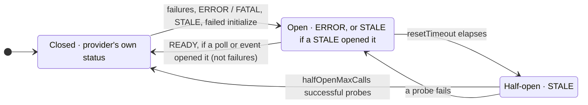

# Extras

`zio-openfeature-extras` adds two providers that need no flag service, [HOCON](#hocon-provider) and
[environment variables](#environment-variable-provider), and four wrappers that make any provider faster or safer.

```scala
libraryDependencies += "io.github.etacassiopeia" %% "zio-openfeature-extras" % "<version>"
```

All are plain `FeatureProvider`s: pass them to any factory on [Wiring a provider](providers.md), or chain them with
[`multiProvider`](providers.md#ask-several-providers-in-order), for example environment variables first, then
`application.conf`.

| Wrapper | Passes on events | Passes on provider hooks and `track` |
|---|---|---|
| [`CachingProvider`](#caching-provider) | if the wrapped provider emits them | yes |
| [`CircuitBreakerProvider`](#circuit-breaker-provider) | if the wrapped provider emits them | yes |
| [`DeferredProvider`](#deferred-provider) (takes a function that builds one) | no | yes, once built |
| [`IntegerWideningLongProvider`](#integer-widening-long-provider) | no | yes |

`CachingProvider` and `CircuitBreakerProvider` take over the wrapped provider's event channel, so don't also register
that instance with OpenFeature. Both validate their config and offer three constructors:

- `make` fails with `FeatureFlagError.InvalidConfiguration` naming every field out of bounds.
- `scoped` is `make` plus a finalizer: closing the scope shuts down the wrapper and the wrapped provider (within 10
  seconds). Registering it with `FeatureFlags` too is safe.
- `apply` throws `IllegalArgumentException`.

## HOCON provider

Reads flags from a Typesafe Config block, `feature-flags` by default:

```hocon
# application.conf
feature-flags {
  new-checkout = true
  max-items = 50
  welcome-message = "Hello!"
  settings {
    timeout = 30
  }
}
```

```scala
--8<-- "Extras.scala:hocon"
```

- A nested block is an object flag, and a dotted key such as `settings.timeout` resolves the nested path. A present key
  answers with reason `Static`.
- A value of the wrong type is a `TypeMismatch`; one Typesafe Config cannot parse is a `ParseError`. HOCON has one
  number type, so an int read accepts any number whose value survives (`2.0` is `2`, `1.5` is a `TypeMismatch`), and
  Typesafe's conversions apply (`"42"` parses).
- An absent key is `FLAG_NOT_FOUND`, so a [provider chain](providers.md#ask-several-providers-in-order) moves on. So is a
  key with a character HOCON reserves in a path (`:`, `@`, `#`, `$`, `,`, `=`, brackets, quotes) or an empty element
  (`a..b`): it cannot be present.

!!! warning "A missing path is silent"
    If the `path` you pass to `HoconProvider(path)` does not exist, the provider starts empty: every flag is
    `FLAG_NOT_FOUND`, with no error.

`reload()` re-reads the config; on failure the provider keeps the old config and its `getState` reports `ERROR` until a
reload succeeds. It sends no event, so `FeatureFlags` keeps its status: check `reload()`'s result. A `fromConfig` provider has nothing to re-read.

```scala
--8<-- "Extras.scala:hocon-reload"
```

## Environment variable provider

Reads each flag from one variable: a prefix (default `FF_`) plus the upper-cased flag key with `-` and `.` turned into
`_`, so `new-checkout` reads `FF_NEW_CHECKOUT`, whatever the JVM's default locale.

```scala
--8<-- "Extras.scala:env"
```

`withLookup` takes any `String => Option[String]`, handy in tests. Booleans accept `true`/`false`, `yes`/`no`,
`on`/`off` and `1`/`0` in any case; numbers whatever `toInt`, `toLong` or `toDouble` parses; strings and objects the raw
value. A set but unparsable variable is a `ParseError`, so a typo is visible; an unset one is `FLAG_NOT_FOUND`.

## Caching provider

Keeps a provider's answers for a while, using [zio-cache](https://github.com/zio/zio-cache):

```scala
--8<-- "Extras.scala:caching"
```

- Repeats within `ttl` are served from the cache with reason `Cached`. Entries are keyed by flag key, flag type and
  evaluation context; concurrent callers for the same entry share one provider call, even with different defaults.
- Errors and `DEFAULT`-reason answers are never cached, so a transient failure is retried. A caller that shared
  another caller's provider call is not handed that call's failure: it evaluates once more itself, on its own thread.

| `CachingConfig` field | Default | Meaning |
|---|---|---|
| `maxEntries` | `1000` | entries kept before the least recently used is evicted; at least `1` |
| `ttl` | `5.minutes` | how long an entry is served; greater than zero, `Duration.Infinity` never expires |
| `contextKeys` | `None` | context attributes that make up the cache key; `None` uses the whole context |

A per-request attribute such as a request id makes every evaluation its own entry, so nothing is served from cache.
Name the attributes that change the answer:

```scala
--8<-- "Extras.scala:caching-context-keys"
```

With `contextKeys` set, the targeting key is left out of the cache key too; `Some(Set.empty)` caches by flag key alone.
The key takes each attribute's type and shape, not just its text: `"30"` and `30` are different keys, as are lists
and structures that print alike.

When the wrapped provider (an OpenFeature `EventProvider`) emits `PROVIDER_CONFIGURATION_CHANGED`, the whole cache is
cleared and the event passed on. Any other provider (including one inside `DeferredProvider` or
`IntegerWideningLongProvider`) can serve a changed flag for up to `ttl`: put `CachingProvider` closest to the
event-capable provider, pick `ttl` for the staleness you can afford, or clear the cache yourself.

```scala
--8<-- "Extras.scala:caching-invalidate"
```

## Circuit breaker provider

`CircuitBreakerProvider` stops calling a failing remote provider, so evaluations stop waiting on timeouts and the next
provider in a `firstSuccessful` chain answers:

```scala
--8<-- "Extras.scala:circuit-breaker"
```





The state names show the status the breaker reports. It emits `PROVIDER_STALE` when failures open it and
`PROVIDER_READY` when a probe closes it. A `PROVIDER_READY` from the provider is passed on only once the circuit is
closed: while failures keep it open the event is held, and the probe that closes it emits the `READY`. After
`resetTimeout` the next call is a probe.

**What counts as a failure.** A call slower than `evaluationTimeout`, or one that throws or returns `GENERAL`,
`PROVIDER_NOT_READY` or `PROVIDER_FATAL`. Other answers (`FLAG_NOT_FOUND`, type mismatch, invalid context) prove the
provider is reachable and reset the count.

**Other ways it opens.** At most once per `stateCheckInterval` the breaker polls the provider's state: `ERROR` or
`FATAL` opens, and a polled `READY` closes a circuit a poll opened. With an `EventProvider`, `PROVIDER_ERROR` opens and
`PROVIDER_READY` closes a circuit an event or a poll opened. A failed `initialize` opens it too, and a `STALE` provider
opens it under the default `stalePolicy`. `HalfOpen` lets the next call probe a circuit the provider's own `ERROR`,
`FATAL` or failed `initialize` opened, instead of waiting `resetTimeout`; on a closed circuit, or one that failures
opened, it changes nothing. `Ignore` does nothing. A circuit
opened by failures closes only through `resetTimeout` and a successful probe.

**What an open circuit reports.** `ERROR`, except when the provider's `STALE` opened it: then it reports `STALE`,
the provider's own health, while it still rejects calls. A later `ERROR` or `FATAL` from the provider, or a failed
probe, makes it report `ERROR`. At startup this decides whether a synchronous build accepts the stack: under the
default `Open` policy a provider that is `STALE` while it starts builds with status `Stale`, and its calls are rejected
until the circuit closes as described above. Under `HalfOpen` and `Ignore` it builds as the provider reports and
nothing is rejected.

A rejected call fails with a `GeneralError`, for example `Circuit breaker rejected: open for 4210ms due to consecutive
failures, resets after 30000ms`. The reason is `consecutive failures`, `delegate reported unhealthy state`,
`delegate reported STALE`, `delegate state poll reported unhealthy`, `delegate state poll reported STALE` or, during a
half-open probe, `half-open, probe in progress`.

| `CircuitBreakerProviderConfig` field | Default | Meaning |
|---|---|---|
| `failureThreshold` | `5` | consecutive failures that open it; at least `1` |
| `resetTimeout` | `30.seconds` | how long the circuit stays open before a probe; greater than zero. `Duration.Infinity`: only a `READY` signal closes it, so a circuit opened by failures stays open |
| `evaluationTimeout` | `500.millis` | longest wait for one call, above zero; `Duration.Infinity` disables it |
| `halfOpenMaxCalls` | `1` | successful probes that close the circuit; at least `1` |
| `stalePolicy` | `StalePolicy.Open` | what a `STALE` provider does: `Open`, `HalfOpen` or `Ignore` |
| `stateCheckInterval` | `1.second` | state poll interval; `Duration.Zero` polls every call, `Duration.Infinity` once |

??? note "Timeouts and provider hooks"
    A finite `evaluationTimeout` runs the wrapped provider on another thread, so a wrapped `MultiProvider`'s members see
    the hook domain `"multiprovider"`. Wrap each member in its own breaker, or set `evaluationTimeout = Duration.Infinity`
    (keeps the caller's thread, but a hung provider then blocks the caller without counting as a failure).

## Deferred provider

Some providers do their network work in the constructor, which blocks wherever you build them. `DeferredProvider` takes
a function that builds the provider and calls it when OpenFeature initializes it, on the SDK's own thread with async
initialization, so startup does not wait:

```scala
--8<-- "Extras.scala:deferred"
```

- Until the real provider is built, evaluations answer `PROVIDER_NOT_READY`. Events are not passed on.
- After shutdown or a failed start it cannot be restarted; build a new one.
- To answer from a fallback meanwhile, use [`fromAcquireAsync`](providers.md#start-on-a-fallback-fromacquireasync).

## Integer widening long provider

`FeatureFlags.long` uses the provider's own long resolver. A provider written before OpenFeature Java SDK 1.22 has none,
and the SDK's stand-in uses the double resolver, which may reject an integer flag. Wrap such a provider to read `Long` flags through its integer resolver:

```scala
--8<-- "Extras.scala:integer-widening"
```

- A default that fits in an `Int` goes through the integer resolver and is widened; a larger one takes the long path. On
  a type mismatch (a value beyond `Int` range) the evaluation is retried on the long path. A provider that silently
  truncates such a value cannot be detected.
- Events and `getState` are not forwarded: the wrapper always reports `READY`, so a
  [circuit breaker](#circuit-breaker-provider) around it cannot see the real state.
