# Hooks

A hook runs your code around every flag evaluation: to log it, time it, audit it, or add context to it. Hooks are
plain ZIO values, written once and registered where they should apply.



## Writing a hook

Extend `FeatureHook` and override the stages you need. Every stage has a no-op default.

```scala
--8<-- "Hooks.scala:custom"
```

| Stage | Runs | Receives |
|---|---|---|
| `before` | before the provider is called | the context so far; may return extra context |
| `after` | when the provider answered with a value and no error code | the `FlagResolution` |
| `error` | when the evaluation failed or the provider answered with an error code | the `FeatureFlagError` |
| `finallyAfter` | always, last | `Some(resolution)` if the provider answered, otherwise `None` |

Every stage also receives the `HookContext` (`flagKey`, `flagType`, `defaultValue`, `evaluationContext`,
`clientMetadata`, `providerMetadata`, `hookData`) and the evaluation's `HookHints`.

A `TypeMismatch` handed to `error` names the type the caller asked for in `expected`, as the caller's own failure
does; the wire type the provider was asked for is `ctx.flagType`.

## Registering hooks

```scala
--8<-- "Hooks.scala:register"
```

| Level | Register with | Applies to |
|---|---|---|
| ZIO API | `addZioApiHook`, `addZioApiHooks` | every evaluation of this instance, ahead of client hooks; a [`FeatureFlagRegistry`](providers.md) adds them to all its clients |
| Client | `addHook`, `addHooks`, `FeatureFlagsConfig().withHook(...)` / `withHooks(...)` | every evaluation of this instance |
| Invocation | `EvaluationOptions(hooks*)`, `.withHook`, `.withHooks` | one call, through any method that takes `EvaluationOptions` |
| Java API | `addApiHook(javaHook)` | a `dev.openfeature.sdk.Hook`, run by the Java SDK |
| Provider | the provider itself | run by the Java SDK |

`FeatureFlags.hooks` and `zioApiHooks` list what is registered; `clearHooks`, `clearZioApiHooks` and `clearApiHooks`
remove it.

```scala
--8<-- "Hooks.scala:manage"
```

??? note "Java SDK hooks"
    Hooks written for the Java SDK run inside the provider call. The Java API is shared by every instance on the same
    `OpenFeatureAPI`: `clearApiHooks` also clears its siblings' API hooks, and logs a warning.

    ```scala
    --8<-- "Hooks.scala:java-hook"
    ```

## Built-in hooks

```scala
--8<-- "Hooks.scala:builtins"
```

| Hook | What it does |
|---|---|
| `FeatureHook.logging(logBefore, logAfter, logError)` | plain log lines: `before` at debug (off by default), `after` at info, `error` at error |
| `FeatureHook.structuredLogging(beforeLevel, afterLevel, errorLevel, logContext, redactKeys)` | log lines with `flag.*` annotations (`before` and `after` at debug, `error` at warning by default); `logContext` adds `flag.context.*` minus `redactKeys` |
| `FeatureHook.metrics((key, duration, success) => ...)` | calls you once per evaluation with its duration |
| `FeatureHook.metricsDetailed(onSuccess, onError)` | the same, with the `HookContext` and the resolution or error |
| `FeatureHook.contextValidator(requireTargetingKey, requiredAttributes)` | warns when the targeting key or an attribute is missing; never fails |
| `FeatureHook.noop` | does nothing |
| `FeatureHook.compose(hooks)` | one hook that runs several, in the order above |

## Order and outcomes

`before` runs ZIO API hooks, then client hooks, then invocation hooks, each in the order added. `after`, `error` and
`finallyAfter` run in the **reverse** order, like nested `try` / `finally` blocks.

- A clean answer runs `after`, then `finallyAfter`.
- An answer with an error code (`FLAG_NOT_FOUND`, `TYPE_MISMATCH`, ...) runs `error`, not `after`, on both
  [tiers](evaluating.md): `booleanOrDefault` serves your default, and the hooks still see the error.
- An answer whose value does not decode to your type runs `error`, and `finallyAfter` gets the resolution the total
  tier serves: your default, reason `ERROR`, code `TYPE_MISMATCH`.
- A failure without an answer (provider not ready, timeout, exception) runs `error`, and `finallyAfter` gets `None`.
  Hooks run before the status check, so a not-ready provider still runs `before`, `error` and `finallyAfter`.
- Interrupting the evaluation from outside, for example with `.timeout` around your call, does not run `error`;
  `finallyAfter` still runs.
- Values served by a [transaction](transactions.md) override or its cache run hooks too.

### Failing hooks

Stages return `UIO`, so a hook cannot fail an evaluation. Handle anything that may fail inside the hook:

```scala
--8<-- "Hooks.scala:safe"
```

A defect (a thrown exception) in `before` or `after` skips the rest of that stage, runs `error` with a
`ProviderError`, runs `finallyAfter`, and then fails the evaluation with that defect. After an `after` defect,
`finallyAfter` receives your default with reason `Error` and code `General`.

## Adding context in `before`

`before` may return extra context. It wins over every [context level](context.md), and later hooks see it. To add
context without overriding what callers pass, use a [context source](context.md#context-sources) instead.

```scala
--8<-- "Hooks.scala:enrich"
```

## Passing data between stages

`HookData` is a store private to one hook during one evaluation: write in `before`, read in a later stage. A
`TypedKey` keeps the value's type; `String` keys also work. It offers `set`, `get`, `getOrElse`, `remove` and `clear`.
Each hook inside a `FeatureHook.compose` gets its own `HookData`.

```scala
--8<-- "Hooks.scala:hook-data"
```

`HookHints` are read-only values the caller hands to every hook of one evaluation, through `EvaluationOptions`
(`.withHint("requestId", "r-17")`). Read them with `get` and `getOrElse`, by `String` or `TypedKey`; combine them with
`add`, `+` and `++`.

```scala
--8<-- "Hooks.scala:hints"
```

## Filtering by flag type

A hook runs only for evaluations whose type is in its `supportedFlagTypes` (all by default): `Boolean`, `String`,
`Int`, `Long`, `Double` or `Object`. The type is the one the provider is asked for, so a string-backed enum counts as
`String`.

```scala
--8<-- "Hooks.scala:flag-types"
```

!!! tip "Keep hooks fast"
    Hooks run on the calling fiber, in sequence, on every evaluation. Keep them in memory and fork slow work with
    `.forkDaemon`.
