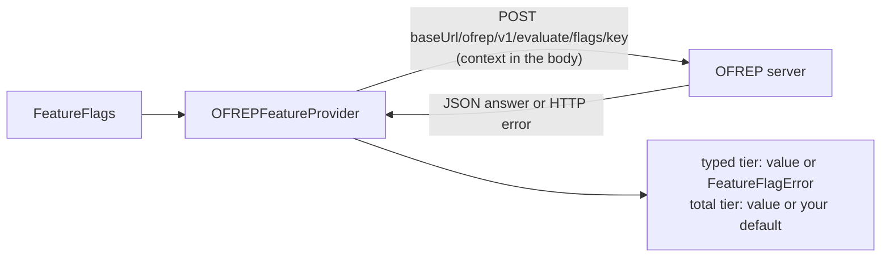

# OFREP

The [OpenFeature Remote Evaluation Protocol](https://github.com/open-feature/protocol) (OFREP) is a vendor-neutral
HTTP API for evaluating flags on a server. flagd, OFREP relays and a growing number of flag services speak it.
`zio-openfeature-ofrep` connects to any of them.

```scala
libraryDependencies += "io.github.etacassiopeia" %% "zio-openfeature-ofrep" % "<version>"
```

It builds on the OpenFeature contrib `ofrep` provider (0.0.2). Both it and the protocol are young, so pin the version
deliberately. The module is separate from [Extras](extras.md) because it brings Jackson, Guava and SLF4J with it.

## Quick start

```scala
--8<-- "Ofrep.scala:quick-start"
```



Every evaluation is one HTTP call. The provider has no start-up step, so it is ready as soon as it is registered.

## Creating the provider

`OFREPProvider.make` checks the base URL before building anything: it must be non-empty, parse as a URI, use `http` or
`https`, and name a host. Anything else fails with `FeatureFlagError.InvalidConfiguration`, so a typo stops your app at
startup instead of at the first evaluation.

`make` returns an `IO`; `scoped` and `layer` shut the provider down with their scope or layer, while a provider from
`make` is shut down by the `FeatureFlags` layer you register it with. Each takes a base URL, an `OFREPProviderConfig`,
or the contrib provider's own `OfrepProviderOptions`.

```scala
--8<-- "Ofrep.scala:lifecycle"
```

## Configuration

```scala
--8<-- "Ofrep.scala:config"
```

| `OFREPProviderConfig` field | Default | Meaning |
|---|---|---|
| `baseUrl` | required | the OFREP server |
| `requestTimeout` | the contrib provider's | longest wait for one HTTP request |
| `connectTimeout` | the contrib provider's | longest wait to open a connection |
| `headers` | none | headers sent with every request, such as an `Authorization` token |
| `proxy` | the JVM's default | a `java.net.ProxySelector` for the HTTP traffic |

Keep `FeatureFlags`' `evaluationTimeout` (one second by default) at or below `requestTimeout`.

## When something goes wrong

| What happens | Typed tier | Total tier |
|---|---|---|
| The server answers 401 or 403 | fails with `Unauthorized` | your default, error code `General` |
| The server answers another 4xx or 5xx | fails with the error the response names (`ProviderError` for `GENERAL`) | your default, with that error code |
| The server cannot be reached | fails with `Unreachable` (or `ProviderError`) | your default, error code `General` |
| The response is not OFREP JSON (an HTML error page, an empty body, truncated JSON), whatever the status | fails with `ProviderError` | your default, error code `General` |

To alert on the total tier, check the resolution's error code:

```scala
--8<-- "Ofrep.scala:alerting"
```

## With a circuit breaker

`CircuitBreakerProvider` from [Extras](extras.md#circuit-breaker-provider) wraps the OFREP provider directly:

```scala
--8<-- "Ofrep.scala:circuit-breaker"
```

The contrib provider reports `READY` and emits no state events, so only failed calls trip the breaker: network errors,
`GENERAL` answers (401, 403, 429, 5xx, and any answer that is not OFREP JSON, such as a proxy's HTML error page) and
calls slower than the breaker's `evaluationTimeout`. A 404 (`FLAG_NOT_FOUND`) or a type error proves the server is
reachable and does not count. A 429 whose body is not JSON counts as a failure but cannot set the rate-limit window:
the contrib provider reads `Retry-After` only from a response it could parse.

## `Long` flags

`FeatureFlags.long` reads JSON integers exactly. Anything else the server sends for a long read, including a whole
decimal such as `2.0`, is a `TypeMismatch`. Use `make`, `scoped` or `layer`: the contrib provider on its own rejects
every integer flag on a long read.

## Notes

??? note "Contrib provider details"
    - `OFREPFeatureProvider` wraps the contrib `OfrepProvider`; `.underlying` returns it.
    - HTTP calls run on a pool of daemon threads, so the provider never keeps your JVM from exiting. If you build
      `OfrepProviderOptions` yourself, start from `OFREPProvider.daemonOptionsBuilder()`: the contrib default is a pool
      of non-daemon threads.
    - `OFREPProvider()`, `OFREPProvider(baseUrl)` and `OFREPProvider.fromOptions(options)` are deprecated. They skip
      the URL checks and return the bare contrib provider, without `Long` support.
