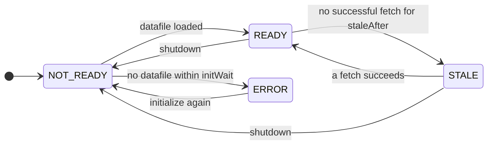

# Optimizely

`zio-openfeature-optimizely` serves flags from
[Optimizely Feature Experimentation](https://www.optimizely.com/products/feature-experimentation/), built on the
official Java SDK: it downloads your project's datafile and makes every decision locally.

```scala
libraryDependencies += "io.github.etacassiopeia" %% "zio-openfeature-optimizely" % "<version>"
```

The module brings `jackson-databind`, which the SDK needs but does not declare; if gson is also present the SDK prefers
it (`-Doptimizely.default_parser=` picks one). With no parser, `make` fails with `InvalidConfiguration`.

## Quick start

Copy the SDK key from [app.optimizely.com](https://app.optimizely.com) under **Settings → Environments**; each
environment has its own.

```scala
--8<-- "Optimizely.scala:quick-start"
```

!!! warning "Every evaluation needs a targeting key"
    The context's targeting key is the Optimizely user id. Without one, the typed tier fails with `TargetingKeyMissing`
    and the total tier serves your default. Set it per call or via [context](context.md).

## Startup

`make` validates the key and builds the SDK client, which fetches `https://cdn.optimizely.com/datafiles/<sdkKey>.json`. A key is 6 to 128 characters of `A-Z`, `a-z`, `0-9`, `_` or `-`,
and not a placeholder such as `YOUR_SDK_KEY`; anything else fails with `InvalidConfiguration`.



`initWait` (25 s) is shorter than `initTimeout` (30 s), so a datafile that never loads reports the provider's own
error. `STALE` still serves the last datafile (see [below](#datafile-updates-and-staleness)); how `FeatureFlags` treats
each state is in [Lifecycle](lifecycle.md).

The provider owns a polling thread and an HTTP client; a `FeatureFlags` layer shuts it down on close. Otherwise use
`scoped` or `layer`, which shut it down with their scope:

```scala
--8<-- "Optimizely.scala:scoped"
```

`make` and `layer` take the key, the key and a datafile URL, or an `OptimizelyProviderConfig`; `scoped` the key or a
config.

## Reading flags

| You ask for | You get |
|---|---|
| `boolean` | whether the flag is enabled for this user |
| `string` | the variable `value`; else the variation key; else your default |
| `int`, `long`, `double`, `obj` | the variable `value`; else your default |

A variable of another type is a `TypeMismatch`, never a silent default or a parse:

Each type accepts its own variables only: `int` an integer within `Int`, `long` any integer, `double` any integer or
double, `string` a string, `obj` JSON.

To read a variable other than `value`, set the context attribute `openfeature.variableKey`
(`OptimizelyFeatureProvider.VariableKeyAttribute`):

```scala
--8<-- "Optimizely.scala:variables"
```

```scala
--8<-- "Optimizely.scala:object-flag"
```

The reason is `TargetingMatch` when the user got a variation, else `Default`. Metadata carries `optimizely.flagKey` and
`optimizely.ruleKey`.

| Error code | Likely cause |
|---|---|
| `TargetingKeyMissing` | no user id on the context |
| `FlagNotFound` | misspelled key, or flag missing from this environment |
| `ProviderNotReady` | datafile not loaded yet, or provider shut down |
| `TypeMismatch` | the variable has another type |
| `General` | the SDK failed to decide, including a failed CMAB fetch |

??? note "Things to know"
    - Context attributes become audience attributes: strings, booleans, numbers as they are, an `Instant` as ISO-8601;
      lists and structures are left out.
    - CMAB experiments are supported. On a cache miss, a CMAB decision blocks on Optimizely's CMAB endpoint (up to about
      10 seconds, one retry), so set an affordable `evaluationTimeout` or add a `CircuitBreakerProvider`.

## Tracking and events

`FeatureFlags.track` ([Tracking](tracking.md)) sends a conversion for the targeting key. Attributes become event tags,
and `value` the `value` tag. The `revenue` metric expects integer cents: pass an integer attribute
named `revenue`; it is never derived from `value`.

```scala
--8<-- "Optimizely.scala:track"
```

`track` fails when the provider is neither `READY` nor `STALE`, the context has no targeting key, or the datafile has no
such event.

Providers from `make`, `scoped` and `layer` send an impression per decision (rollouts too, if the project's "send flag
decisions" setting is on) and a conversion per `track` to `logx.optimizely.com`, batched from a background thread.
`OptimizelyEvents.Batched` tunes it:

| `Batched` parameter | Default | Meaning |
|---|---|---|
| `batchSize` | 10 | events per request; at least 1 |
| `flushInterval` | 30 s | longest an event waits before its batch is sent; positive |
| `closeTimeout` | 3 s | on shutdown, the wait for the queue and again for in-flight requests; positive, at most 4 s |

Events still queued when `closeTimeout` runs out are dropped. `OptimizelyEvents.Disabled` sends nothing.

```scala
--8<-- "Optimizely.scala:events-tuned"
```

A provider from `fromOptimizelyClient` sends events however its client was built.

## Datafile updates and staleness

A new datafile revision makes the provider emit `ConfigurationChanged` with an empty set of flag keys (the SDK does not
say which changed): read again.

```scala
--8<-- "Optimizely.scala:config-changed"
```

A failed fetch silently leaves the last datafile in use, unless the staleness watchdog is on. It runs only when you set
`pollingInterval`: the provider goes `STALE` after `staleAfter` without a successful fetch and `READY` when one
succeeds, answering from the last datafile meanwhile.

## Startup modes and resilience

| | Async (quick start) | Sync (fail fast) | With a fallback |
|---|---|---|---|
| Starts while Optimizely is down | yes; evaluations fail until ready | no, the build fails | yes; the fallback answers |
| Outage after startup | last datafile | last datafile | last datafile, or the fallback while the breaker is open |
| Good for | experiments, UI changes | flags guarding money or safety | flags whose default would be wrong |

**Fail fast.** Initialize synchronously; the build fails if the datafile misses `initTimeout`:

```scala
--8<-- "Optimizely.scala:fail-fast"
```

**Async.** Gate readiness on the status; `Stale` counts as ready:

```scala
--8<-- "Optimizely.scala:readiness"
```

**Fallback.** [`CircuitBreakerProvider`](extras.md#circuit-breaker-provider) opens while it reports `ERROR`, `FATAL` or (by default)
`STALE`; put a fallback behind it for flags that need a sensible value in an outage:

```scala
--8<-- "Optimizely.scala:circuit-breaker"
```

The fallback hides outages, so alert on `Fatal` soon after start (wrong key or unreachable datafile URL) and on `Stale`.

## Configuration reference

```scala
--8<-- "Optimizely.scala:config"
```

| `OptimizelyProviderConfig` field | Default | Meaning |
|---|---|---|
| `sdkKey` | required | the environment's SDK key |
| `datafileUrl` | the Optimizely CDN | where to fetch the datafile |
| `initWait` | 25 s (`OptimizelyProvider.DefaultInitWait`) | first-datafile wait; keep below `initTimeout` |
| `pollingInterval` | the SDK's, 5 min | datafile fetch interval; setting it turns on the watchdog; positive |
| `blockingTimeout` | the SDK's, 10 s | longest the SDK blocks for a config; positive |
| `staleAfter` | 3 × `pollingInterval` | time without a successful fetch before `STALE` (watchdog on); positive |
| `events` | `OptimizelyEvents.Batched()` | see [Tracking and events](#tracking-and-events) |

A non-positive `pollingInterval`, `blockingTimeout` or `staleAfter`, or an out-of-range `Batched` value, fails with
`InvalidConfiguration`.

### Self-hosted Optimizely Agent

To fetch the datafile from an [Optimizely Agent](https://docs.developers.optimizely.com/feature-experimentation/docs/agent)
in your network, pass its URL (`http` or `https`, with a host).

```scala
--8<-- "Optimizely.scala:agent"
```

### Bring your own client

To wrap an `Optimizely` client you manage (the provider never closes it), build it with a `CmabService`, as
`OptimizelyFactory` does, if you use CMAB experiments:

```scala
--8<-- "Optimizely.scala:own-client"
```

To test without Optimizely, use [Testkit](testkit.md); to fault-test the real provider, see
[Testing real providers](testing-real-providers.md).
