# Wiring a provider

A `FeatureFlags` layer wraps one [OpenFeature](https://openfeature.dev/) provider.

## Use any OpenFeature provider

```scala
--8<-- "Providers.scala:any-provider"
```

Any provider written for the [OpenFeature Java SDK](https://openfeature.dev/docs/reference/technologies/server/java)
works, for example [flagd](https://flagd.dev/), [LaunchDarkly](https://launchdarkly.com/) or
[Flagsmith](https://flagsmith.com/), from `"dev.openfeature.contrib.providers" % "<name>"`. This library adds
[HOCON, environment variable](extras.md), [OFREP](ofrep.md) and [Optimizely](optimizely.md) providers; for tests use
`TestFeatureProvider` from the [testkit](testkit.md).

## Pick a factory

| You want | Use |
|:--|:--|
| Start the provider first, failing at startup if it cannot | `FeatureFlags.fromProvider(provider)` |
| Start the app at once; the provider readies in the background | `FeatureFlags.fromProviderAsync(provider)` |
| A domain, hooks, timeouts or other settings | `FeatureFlags.fromProvider(provider, FeatureFlagsConfig(...))` |
| Several providers asked in order | [`FeatureFlags.multiProvider(providers)`](#ask-several-providers-in-order), then any factory above |
| Serve a fallback while a slow provider is built | [`FeatureFlags.fromAcquireAsync`](#start-on-a-fallback-fromacquireasync) |
| One client per domain, created on demand | [`FeatureFlagRegistry.fromProvider`](#one-client-per-domain-featureflagregistry) |

```scala
--8<-- "Providers.scala:shorthands"
```

## Configure it with `FeatureFlagsConfig`

```scala
--8<-- "Providers.scala:config"
```

| Field | Default | Setter | What it does |
|:--|:--|:--|:--|
| `domain` | none | `withDomain(d)` | Binds the client to a named [domain](#domains). |
| `version` | none | `withVersion(v)` | Reported by `clientMetadata`. |
| `initialHooks` | none | `withHooks(list)`, `withHook(h)` | Client-level [hooks](hooks.md) from the start. |
| `evaluationTimeout` | `Default`: 1 second | `withEvaluationTimeout(d)`, `withoutEvaluationTimeout` | Bounds each evaluation (`Default`, `After(d)` or `Disabled`); see [Evaluating flags](evaluating.md). |
| `initTimeout` | 30 seconds | `withInitTimeout(d)` | Bounds initialization. |
| `initMode` | `InitMode.Sync` | `withAsyncInit`, `withSyncInit` | [Sync or async start](#sync-or-async-start). |
| `apiOwnership` | `ApiOwnership.Auto` | `withApiOwnership(o)` | [Whether shutdown stops the API](#who-shuts-down-the-api). |
| `contextSource` | empty | `withContextSource(s)` | Ambient [context](context.md) read on every evaluation. |
| `fallbackLogging` | `FallbackLogging.Default` | `withFallbackLogging(p)` | Logging of a served `*OrDefault`: `Off`, `Always` or `Throttled(window)`. |
| `maxAbandonedCalls` | 256 | `withMaxAbandonedCalls(n)` | Cap on timed-out provider calls still running; beyond it evaluations fail fast with `ProviderError`. At least 1. |

## Sync or async start

|  | Sync (`fromProvider`, default) | Async (`fromProviderAsync`) |
|:--|:--|:--|
| The layer is ready | once the provider is `Ready` or `Stale` | at once; evaluations fail with `ProviderNotReady` until then |
| Slower than `initTimeout` | fails with a `TimeoutException` | status `Fatal`, `Error` event with `ProviderFatal` |
| `initialize()` fails | fails with a `GeneralError` (`FatalError` for a fatal outcome) carrying the provider's message | status `Error` |

Either way the provider is shut down once it has failed. A provider stuck in `initialize()` often can't shut down
either, so that `shutdown()` is abandoned rather than awaited: the sync build waits for it at most `initTimeout`
(capped at 15 seconds), and the async `Error` event is published before it starts. A provider the async watchdog shut
down stays registered with the Java SDK, which calls its `shutdown()` again when the instance shuts down or the provider
is replaced, so a provider's `shutdown()` should tolerate a second call.

Use sync when serving a default is worse than not starting: a wrong SDK key then stops the app. Use async to start
fast and gate traffic on [readiness](lifecycle.md#wait-until-the-provider-is-ready), or use a
[fallback](#start-on-a-fallback-fromacquireasync).

## Who shuts down the API

Shutting the OpenFeature API down stops every provider registered on it.

| `apiOwnership` | On shutdown |
|:--|:--|
| `ApiOwnership.Auto` (default) | `Owned` without a domain, `Shared` with one. |
| `ApiOwnership.Owned` | Shuts down the API and its providers. |
| `ApiOwnership.Shared` | Leaves the API and provider running for other clients. The instance still refuses `setProvider` once its scope has closed. |
| `ApiOwnership.Isolated` (`withIsolatedApi`) | A private API for this instance alone, which it owns and shuts down. |

Closing an owning layer's scope waits for a [provider swap](#replace-the-provider-at-runtime) in flight before it
shuts the API down, as `shutdown` does.

!!! warning
    A domain client with the default ownership (`Auto`, which is `Shared` for a domain client) never shuts its provider down. If the provider holds threads or
    connections, set `Owned` or use a [`FeatureFlagRegistry`](#one-client-per-domain-featureflagregistry).

```scala
--8<-- "Providers.scala:owned-domain"
```

## Sharing the SDK

By default every instance uses the process-global `OpenFeatureAPI`, the one the Java SDK and other JVM libraries see.
One API has one default slot and one slot per domain, so instances on it are not independent:

- **Binding a slot that already holds a provider** replaces it: once the new provider is ready, the SDK shuts the
  previous one down, under whatever instance was using it. The build logs a warning naming the slot and both
  providers.
- **An owner's shutdown or scope close tears the API down** for every instance on it. The others then report
  `NotReady`, as after their own `shutdown`: typed reads fail with `ProviderNotReady`, and `*OrDefault` reads serve
  the default. A `FeatureFlagRegistry` does the same to its clients when its scope closes.
- **What is per instance and what is shared.** `setGlobalContext` and `addZioApiHook` belong to this instance
  (`addZioApiHook` is API level in the hook order, not shared across instances). `addApiHook` and `clearApiHooks` act
  on the shared Java API.

- **A provider you registered with the API yourself** is reused as it is: in its own slot, or under any domain when
  it is in the default slot, the instance binds that registration and the SDK runs no second `initialize()`. The SDK
  keeps owning it, so its events reach the status through the SDK's own delivery, in no fixed order unless the
  provider awaits each emission (see [events](lifecycle.md)), and `api.getProvider()` returns it. Every other provider
  is registered through the library's wrapper, which `api.getProvider()` returns instead. A provider registered
  directly under a different domain is not reused: an `EventProvider` fails the build with the SDK's "already
  attached" error, and any other provider is initialized again. Bind it through the library instead.

To keep instances apart, give each one `FeatureFlagsConfig().withIsolatedApi`, a domain of its own, or build them all
from one [`FeatureFlagRegistry`](#one-client-per-domain-featureflagregistry).

## Ask several providers in order

`FeatureFlags.multiProvider` combines providers into one (the Java SDK's `MultiProvider`). Pass it to any factory:

```scala
--8<-- "Providers.scala:multi-provider"
```

The strategy decides when the chain moves on:

| Strategy | Moves on when a provider | Stops at |
|:--|:--|:--|
| `MultiProviderStrategy.firstMatch` (default) | reports `FLAG_NOT_FOUND` | the first answer that is not "flag not found", including an error |
| `MultiProviderStrategy.firstSuccessful` | reports any error, including `FLAG_NOT_FOUND` | the first answer without an error |

```scala
--8<-- "Providers.scala:multi-provider-strategy"
```

- A provider must answer `FLAG_NOT_FOUND` for a key it does not hold; reason `DEFAULT` with no error code counts as a
  match and ends the chain.
- When no provider has the flag, `firstMatch` gives `FLAG_NOT_FOUND` (the caller's default); `firstSuccessful` gives a
  `GENERAL` error carrying every provider's error.
- A custom strategy implements `MultiProviderStrategy.Strategy`. For `track` in a chain, see [Tracking](tracking.md);
  for a `DeferredProvider` member, see [Extras](extras.md#deferred-provider).
- The chain's status is the worst of its members' (`Fatal`, then `NotReady`, `Error`, `Stale`, `Ready`), as the
  specification's Multi-Provider appendix prescribes. Once the chain has initialized, a member's `READY`, `STALE` or
  `ERROR` event reaches your handlers, with that member's details, only when it changes the chain's status; its
  configuration changes always do. Under `firstSuccessful` one `Fatal` member therefore makes the whole chain `Fatal`,
  although another member could answer. A member that sends no events (not an `EventProvider`, such as a
  `DeferredProvider`) counts as `Ready` once the chain has initialized.
- The chain takes over its members' event channels, as the SDK does for a registered provider. A member whose channel
  something else already holds (it is also registered with an API, sits in another chain, or appears twice in this
  one) keeps it, and counts in this chain as a member that sends no events.

??? note "Hand-built `MultiProvider`"
    Unlike `FeatureFlags.multiProvider`, a `new MultiProvider(...)` fails integer values with `TYPE_MISMATCH` (wrap it
    in [`IntegerWideningLongProvider`](extras.md#integer-widening-long-provider)) and drops `track` events.

## Start on a fallback: `fromAcquireAsync`

Some providers do network work in the constructor, so even `fromProviderAsync` blocks. `fromAcquireAsync` takes the
provider as an effect: the layer starts at once on a fallback while a background fiber builds, verifies and initializes
the real provider, then switches to it. The status is `Ready` throughout:



```scala
--8<-- "Providers.scala:acquire"
```

The layer's error type is `Nothing`: a real provider that never comes up is retried, reported to
`onConstructionError`, and the fallback keeps serving.

`fromAcquireAsync(acquire, fallback, config, acquireConfig)` takes two effects and two settings objects;
`fromAcquireAsync(acquire, fallback)` and `fromAcquireAsync(acquire, fallback, config)` use the defaults for the rest.

| Argument | Meaning |
|:--|:--|
| `acquire` | Builds the real provider. Register cleanup in its `Scope` so a rejected one is closed. |
| `fallback` | Builds a fallback; runs again for the swap, so return a fresh instance each time. |
| `config` | A [`FeatureFlagsConfig`](#configure-it-with-featureflagsconfig): domain, version, hooks, timeouts (`initTimeout` bounds the swapped-in provider's initialization), API ownership, context source, fallback logging and `maxAbandonedCalls`. `initMode` does not apply: the fallback serves at once and the real provider always comes later. |
| `acquireConfig` | An `AcquireConfig`: what only this path takes, below. |

| `AcquireConfig` | Default | Meaning |
|:--|:--|:--|
| `withVerify(f)` | accept | Checks the real provider before the swap; a failure is a failed attempt ([below](#verify-the-candidate)). |
| `withCompose(f)` | `FeatureFlags.defaultAcquireCompose` | Combines real and fallback into the swapped-in provider. The default asks the real one first and falls back on any error. |
| `withConstructionRetry(s)` | `Schedule.recurs(3) && Schedule.exponential(1.second).jittered` | Retries `acquire` plus `verify`. |
| `withConstructionTimeout(d)` | 30 seconds | Bounds one attempt. |
| `withOnSwapped(effect)` | nothing | Runs once the real provider serves. |
| `withOnConstructionError(f)` | nothing | Runs when all attempts or the swap failed. |

The earlier form, which took `evaluationTimeout`, `initTimeout`, `contextSource`, `fallbackLogging` and
`maxAbandonedCalls` as named arguments next to the `AcquireConfig` settings, is deprecated since 1.3.0.

### Verify the candidate

A provider with a wrong key can still answer, with wrong values. `Verify.flagExists[A](key, context)` asks the
candidate for a flag you know exists and rejects it on any error code (`Verify.VerificationFailed`). `Verify.all`
chains checks; any `FeatureProvider => Task[Unit]` is one.

```scala
--8<-- "Providers.scala:acquire-verify"
```

The check runs before `initialize()` and without global or ambient context, so initialize inside `acquire` a provider
that only answers afterwards.

### Which provider is serving?

The layer also provides `AcquireStatus`: `Constructing`, then `Live` or `Failed(cause)`.

```scala
--8<-- "Providers.scala:acquire-status"
```

`Live` stays `Live` if the real provider degrades later, and the default `compose` then quietly answers from the
fallback; for ongoing health wrap it in a [`CircuitBreakerProvider`](extras.md#circuit-breaker-provider).

The swap never fails evaluations with `ProviderNotReady`. If initializing the composed provider fails or exceeds
`initTimeout`, the fallback keeps serving and the state becomes `Failed(ProviderSwapFailed(error))`. If you call
`setProvider` yourself first, your provider wins and the state becomes `Failed`.

## Domains

A domain names a client, so different parts of an app can use different providers:

```scala
--8<-- "Providers.scala:client-metadata"
```

### One client per domain: `FeatureFlagRegistry`

`FeatureFlagRegistry` builds one client per domain on demand, on a private API it owns:

```scala
--8<-- "Providers.scala:registry"
```

- `getClient(domain)` builds the client once and returns the same instance afterwards, even for concurrent callers.
  `defaultClient` is the client without a domain.
- A domain without its own provider uses the default one. `setProvider(domain, provider)` registers one, and swaps it in
  if the client exists.
- A provider that fails or is not ready within 30 seconds gives `ProviderInitializationFailed`, and the failed client
  is released. The next `getClient` runs the provider's `initialize()` again (with its own 30 seconds) unless the
  failure was `PROVIDER_FATAL`, which is final and fails at once. A retry that times out leaves that `initialize()`
  running, and later attempts fail until it returns.
- `addZioApiHook(hook)` adds an [API-level hook](hooks.md) to every client, current and future.
- `fromProvider(defaultProvider, config)` applies `version`, initial hooks, the evaluation and init timeouts, context
  source, fallback logging, `maxAbandonedCalls` and init mode to every client (with `withAsyncInit`, `getClient`
  returns before the provider is ready). `domain` and `apiOwnership` do not apply: the registry names each client's
  domain and owns its private API. `fromProvider(defaultProvider)` is the same with `FeatureFlagsConfig()`. Closing
  the scope shuts down the API and every provider.

## Replace the provider at runtime

`FeatureFlagsAdmin.setProvider` swaps the provider of a running instance (add `FeatureFlagsAdmin` to the layer with
`>+> FeatureFlagsAdmin.layer`; the member on `FeatureFlags` is deprecated since 1.3.0). Hooks, context and event
handlers stay. On an instance that has
been shut down it fails with `ProviderNotReady(NotReady)` and does not touch the provider: build a new layer instead.

```scala
--8<-- "Providers.scala:hot-swap"
```



- Evaluations that start during the swap fail with `ProviderNotReady`, and so does one that was already reaching the
  provider when the swap started: the Java SDK picks the slot's provider per call, so its answer may have come from the
  new provider before that provider settled. Swaps are serialized, `setProvider` waits at most `initTimeout`, and a
  started swap finishes even if the caller is interrupted.
- On success the status is the state the Java SDK reports for the new provider: `Ready`, or `Stale` for a provider
  that reports `STALE` while it starts. A restored old provider ends the same way.
- An `ERROR` the new provider reports after its `initialize()` returned, even before `setProvider` has seen the
  outcome, is a status, not a failed swap: `setProvider` succeeds, the status is `Error` (or `Fatal`), and the old
  provider is shut down once, by the SDK. The same holds for a restored old provider during a rollback, and for a
  timed-out swap's provider that initializes late: the provider it replaced is shut down once.
- If `initialize()` throws, `setProvider` fails with `ProviderInitializationFailed` and the old provider is restored (if
  that fails too, the status stays `Error`). A timeout fails the same way, wrapping a `TimeoutException`, with no
  rollback: the SDK would shut the old provider down once the new one became ready.
- A provider instance already bound to another domain of the same API is reused by the SDK: no `initialize()` runs, and
  the swap or build takes the state the provider has. In `Ready` or `Stale` it serves at once. In `Error` or `Fatal`,
  `setProvider` succeeds with that status, and a sync build fails without shutting the provider down, since it still
  serves its other domain. A registry's domains share its default provider this way.
- If the SDK refuses the new provider before binding it (it is attached to, or registered with, another API), nothing is
  initialized again: the previous provider keeps the state it had, and a provider still starting keeps the status it had
  before the swap (`NotReady` while an async build starts, `Error` for a timed-out swap's provider).
- After a timeout the new provider keeps initializing. If it becomes ready, the status recovers to `Ready` and the SDK
  shuts the old provider down. If it fails instead, the status stays `Error` and the old provider, which the SDK no
  longer holds, is shut down; call `setProvider` again to recover. If it has not finished when the instance shuts down
  or its scope closes, the old provider is shut down then. Only an instance that
  [owns its API](#who-shuts-down-the-api) does this: on a shared API the old provider is left to the API's owner.
  Until the new provider has settled, `setProvider` refuses the old provider with `ProviderInitializationFailed`:
  installing it again then would get it shut down later, while it serves. On a shared API the refusal lasts until the
  new provider's `initialize()` returns, since the SDK shuts the old provider down when that call succeeds, whatever the
  slot holds by then. After a rollback that timed out, every instance refuses the failed provider the same way until
  the restored provider's `initialize()` returns. A provider whose earlier `initialize()` has
  not returned (the one an async start was built with, or one a timed-out swap or rollback installed) is refused the
  same way, however many swaps have happened since, until that call returns. If `setProvider` is called while the
  timed-out provider, or the provider an async start was built with, is still initializing and the new provider's
  `initialize()` throws, there is nothing to roll back to: that provider never served and is not initialized a second
  time. The new provider stays registered with status `Error`, that provider is shut down (by an instance that owns
  its API), and a later `setProvider` recovers. Whether `initialize()` returned is read from the Java SDK's own `PROVIDER_READY`, which it
  sends only then, so a new provider that reports `READY` itself from inside its `initialize()` is taken at its word:
  if that `initialize()` then fails, the old provider is not shut down. One that reports `ERROR` from inside an
  `initialize()` that then fails reads as a failed swap. A provider whose metadata has no name is covered the same way, unless
  it initializes and reports an error in the instant between its registration and the library starting to watch for its
  `READY`.
- `setProvider` is the only way out of `Fatal`. With a wrapper such as `CircuitBreakerProvider`, swap in a new wrapper
  around the new provider.
