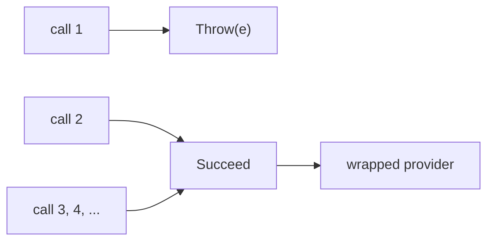

# Testing providers and wrappers

[Testkit](testkit.md) tests your application. This page is for code next to the SDK: a `FeatureProvider` you wrote, a
wrapper around one, or a custom `FlagType`. The tools live in the same `zio-openfeature-testkit` module.

| You wrote | Check it with |
|:----------|:--------------|
| a provider that must survive hangs, errors and slow calls | [`FaultyProvider`](#inject-faults-into-a-provider) |
| a `FlagType` | [`FlagTypeLaws`](#check-a-custom-flagtype) |
| a provider wrapper | [`WrapperLaws`](#check-a-wrapper-passes-every-call-on) |
| a provider, to compare with the test provider | [`DifferentialLaws`](#compare-a-provider-with-the-testkit) |

## Inject faults into a provider

`FaultyProvider` wraps a provider and makes it misbehave on demand: an `initialize()` that never returns, a hanging
`shutdown()`, an error event during startup, a failure on the first call only.

```scala
--8<-- "TestkitSpec.scala:fault-injection"
```

`script(op, faults*)` gives one `Op` a sequence of faults, one per call; the last repeats. An unscripted op calls the
wrapped provider, and `script(op)` with no faults clears the script.



The diagram is `script(Op.EvaluateBoolean, Fault.Throw(e), Fault.Succeed)`.

| `Fault` | Effect |
|:--------|:-------|
| `Succeed` | call the wrapped provider |
| `Throw(error)` | throw `error` without calling it |
| `Delay(d, andThen)` | block the calling thread for `d`, then apply `andThen` (default `Succeed`) |
| `HangUntilReleased` | block until `release` (not `shutdown()`) |
| `HangUntilShutdown` | block until `shutdown()` or `release` |
| `Emit(event, details, andThen)` | emit an OpenFeature event (e.g. `PROVIDER_ERROR` inside `initialize()`), then apply `andThen` |

There is an `Op` for every `FeatureProvider` method: `Initialize` (both overloads), `Shutdown`, `GetMetadata`,
`GetProviderHooks`, `GetState`, `IsDomainScoped`, `Track`, and `EvaluateBoolean` to `EvaluateObject`.

| Factory | Wraps |
|:--------|:------|
| `FaultyProvider.scoped(flags, name)` | a fresh `TestFeatureProvider`; closing the scope releases parked hangs |
| `FaultyProvider.make(flags, name)` | the same, without the finalizer |
| `FaultyProvider.wrapScoped(provider, name)`, `wrap(provider, name)` | any provider |

Prefer the scoped factories: a failing test then still frees parked threads. `delegate` is the wrapped provider (for
`make` and `scoped`, the `TestFeatureProvider`, so `setFlag` works).

| Observe | Returns |
|:--------|:--------|
| `calls`, `calls(op)` | every completed call, in completion order; a hung call appears once it is released |
| `entered(op)` | how many calls of `op` have started, including ones still parked |
| `awaitEntered(op, n)` | waits until `n` calls (default 1) have started; a `release` after it reaches them |
| `release` | unparks every call that entered before it, even one not yet parked; later calls park again |

Each `Call` has `op`, `flagKey` (the event name for `track`), `thread`, `startedAt`, `outcome` (`Outcome.Returned` or
`Outcome.Threw(error)`) and `arguments`.

The wrapped provider's events do not reach `FeatureFlags`: use `Fault.Emit` or the wrapper's `emit`.

## Check a custom `FlagType`

Check a hand-written `FlagType` with `FlagTypeLaws` and a `Gen` for your type:

```scala
--8<-- "TestkitSpec.scala:laws"
```

`celsiusLaws` is a `Spec`; put it in a suite. `all` runs two laws:

| Law | Checks |
|:----|:-------|
| `roundTrip` | `decode(encode(a)) == Right(a)` |
| `throughValueBridge` | the same, after a trip through the OpenFeature SDK's `Value` type |

The second finds the real problems: every number comes back as a `Double` (a `Long` beyond 2^53 as that exact `Long`),
and structure members the SDK cannot represent are dropped. Object-backed types always take that path. Both laws work
on Scala 2.13 too.

## Check a wrapper passes every call on

The OpenFeature SDK adds `FeatureProvider` methods with default bodies, so an older wrapper keeps compiling but answers
them itself instead of asking the wrapped provider: `track` events vanish, or a `Long` evaluation goes through
`getDoubleEvaluation`. `WrapperLaws.delegation` catches this. Give it a name and a function that builds your wrapper
around a provider:

```scala
--8<-- "TestkitSpec.scala:wrapper-laws"
```

The result is a suite with one test per `Op`. Each builds your wrapper around a fresh `FaultyProvider`, calls one method
with distinctive arguments, and checks the wrapped provider received the same call with equal arguments (contexts and
tracking details compared by content), both `initialize` overloads included. It does not look at the results.

`handledByWrapper` lists the ops your wrapper answers itself, each with a reason that becomes part of the test name. For
those, the test checks the call does not reach the wrapped provider, and fails with "allow-list entry no longer needed"
if it does. The law runs on Scala 2.13 and 3; the library's own wrappers are checked with it.

## Compare a provider with the testkit

`DifferentialLaws` checks the test provider's answers against a real provider. It generates flag sets over every wire
type, puts each into `TestFeatureProvider` and your provider, reads every key (and `AbsentKey`) through every typed
accessor, and compares what `FeatureFlags` returns: value, reason class (`Served`, `Default` or `Error`) and error code,
each an `Observed`.

List each intended difference as a `Deviation` with its reason; any other difference fails the test. Here an
environment variable holds text, so a read of another type parses it:

```scala
--8<-- "TestkitSpec.scala:differential"
```

- `seed` builds your provider holding the generated flags.
- A `Disagreement` is one request where the two differ. A deviation's predicate gets the flag set, the `Request` and both
  `Observed` answers; `sameValue` is the strict equality used (`1` is not `1L`, `-0.0` is not `0.0`, `NaN` equals `NaN`).
- A deviation that matched nothing fails as stale, and one filed under another oracle's name fails as misfiled, so the
  list cannot outlive the behaviour it excuses. `Deviation` takes an optional `issue` reference for failure output.
- Each run checks 50 random flag sets (`samples`) plus a fixed `corpus` of edge cases (NaN, -0.0, `Long`s beyond `Int`,
  text that looks like a number). zio-test seeds the randomness, so failures reproduce.
- `flagSets` and `corpus` cover every wire type; `scalarFlagSets` and `scalarCorpus` only booleans, strings, ints and
  doubles. The generators are public (`flagKey`, `hostileString`, `hostileDouble`, `anyInt`, `anyLong`, `objectValue`,
  `anyValue`), as is `requestsFor(flagSet)`.
- `compare` takes the same arguments and returns a `Report` instead of a test: `passed`, `problems` and per-deviation
  counts.

This repository runs it for `HoconProvider`, `EnvVarProvider` and the OFREP provider.

## Run a scenario matrix with zio-bdd

[zio-bdd](https://github.com/EtaCassiopeia/zio-bdd) can run one scenario against several flag configurations, one
`FeatureFlags` layer per `@flags(...)` tag. Override `flagLayer` in your `ZIOSteps` suite; tag values arrive as
strings:

```scala
override def flagLayer(meta: ScenarioMetadata, flags: Map[String, String]): ZLayer[Any, Throwable, FeatureFlags] =
  TestFeatureProvider.layer(Map("new-greeting" -> flags.get("greeting").contains("new")))
```

`@flags(greeting=new, plan=pro)` runs the scenario once with both keys; two `@flags(...)` tags on separate lines run it
once per tag. Coarser hooks: `scenarioLayer`, `featureLayer`, `applicationLayer`. This block is not a compiled snippet:
zio-bdd is a dependency of the `conformance-zio-bdd` module only.

??? note "`CachingReasonProvider`"
    `CachingReasonProvider` reports the `CACHED` reason from the second evaluation of a key on; it always calls the
    wrapped provider and caches nothing (see [`CachingProvider`](extras.md)). It exists so the conformance suite can run
    the spec's `CACHED` scenario.
