# Transactions

A transaction runs a block of code with a consistent view of your flags: it can **override** flags without touching the
provider, **cache** each flag so every read sees the same value, and **record** every flag the block read.



## A first transaction

```scala
--8<-- "Transactions.scala:basic"
```

`transaction` returns a `TransactionResult` with the block's result and what it read. Keys without an override go to
the provider:

```scala
--8<-- "Transactions.scala:mixed"
```

### Parameters

| Parameter | Default | Meaning |
|---|---|---|
| `overrides` | `Map.empty` | flag key → value to serve instead of asking the provider |
| `context` | `EvaluationContext.empty` | context for every evaluation in the block |
| `cacheEvaluations` | `true` | serve repeated reads of a key from the transaction |
| `nested` | `NestedPolicy.Fail` | what to do inside another transaction; see [nesting](#nesting) |

```scala
--8<-- "Transactions.scala:with-context"
```

In the [merge order](context.md#how-levels-merge) the transaction context ranks just above the global context: the
client context, a context source, `withContext` and the call's own context all win over it.

## Overrides

An override is served as is, with reason `Cached`; the provider is not asked, even while it is not ready. That makes
overrides a way to force known values in tests or during an outage. An override of the wrong type fails the read with
`OverrideTypeMismatch`:

```scala
--8<-- "Transactions.scala:type-mismatch"
```

A [custom flag type](typed-flags.md) can be overridden with its value or with the value the provider would store:

```scala
--8<-- "Transactions.scala:custom-type"
```

## Caching

With `cacheEvaluations = true` (the default), the first read of a key calls the provider and the next reads of that
key in the block are served from the transaction with reason `Cached`, keeping the first read's variant and flag
metadata. The block sees one value per flag even if the
flag changes meanwhile.

```scala
--8<-- "Transactions.scala:caching"
```

??? note "Caching details"
    - The cache is keyed by flag key only: a second read with a different context gets the cached value.
    - An answer that carries an error code (such as `FLAG_NOT_FOUND`) is recorded but never served from the cache.
    - A key read again as another type is served from the cache when the cached value converts (an `Int` read as a
      `Long`), and from the provider otherwise.

## What a transaction returns

```scala
--8<-- "Transactions.scala:result"
```

`TransactionResult` holds `result` (the block's result), `evaluatedFlags` (key → `FlagEvaluation`, for every flag read;
a cached re-read adds no second entry) and `overriddenFlags` (keys served from an override). The rest are helpers over
those: counts, membership checks, `toValueMap`, `map`. A `FlagEvaluation` holds `key`, `value`, the full `resolution`,
`wasOverridden` and a `timestamp`.

## Errors

On Scala 3, `transaction` fails with your block's error or a `FeatureFlagError` (a union type). `transactionEither`
keeps them apart, with your error as `Left` and the transaction's as `Right`. Use it on Scala 2.13, where
`transaction`'s error type is `Any`.

```scala
--8<-- "Transactions.scala:either"
```

## Nesting

By default, opening a transaction inside another fails with `NestedTransactionNotAllowed` before the inner block runs.
With `nested = NestedPolicy.Reuse`, the inner call joins the outer transaction, which makes a transaction safe to use
as middleware around code that may open its own.

```scala
--8<-- "Transactions.scala:nested"
```

!!! warning
    Under `Reuse` the inner call's `overrides`, `context` and `cacheEvaluations` are ignored, and its result describes
    the outer transaction so far.

## Fibers

A transaction belongs to the fiber that opened it and to the fibers it forks, which use its overrides and cache and
record their reads in it. Other fibers are not affected.

```scala
--8<-- "Transactions.scala:fibers"
```

## Is there a transaction?

```scala
--8<-- "Transactions.scala:state"
```

| Method | Outside a transaction | Inside one |
|---|---|---|
| `inTransaction` | `false` | `true` |
| `transactionEvaluations` | `None` | `Some(flags read so far)` |
| `currentEvaluatedFlags` | `Map.empty` | flags read so far |

For an audit record prefer `transactionEvaluations`: it cannot confuse "no transaction" with "no flags read".
